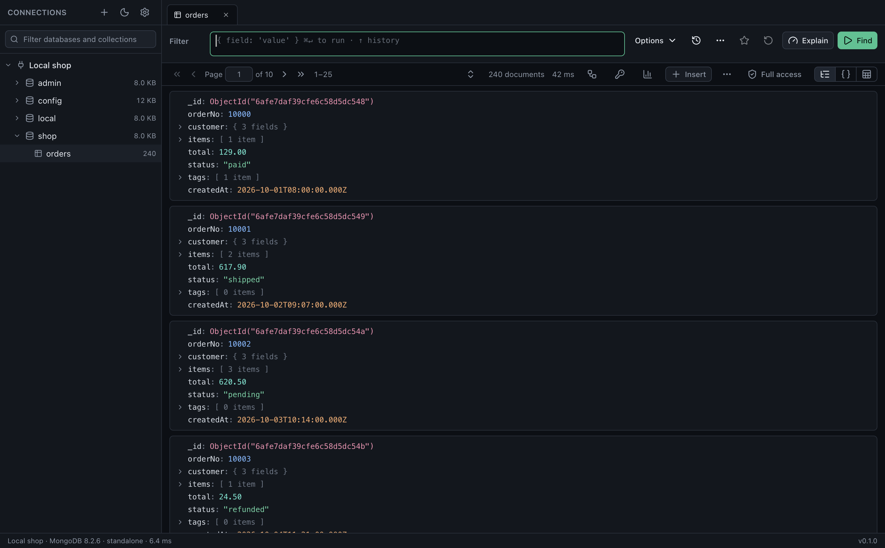
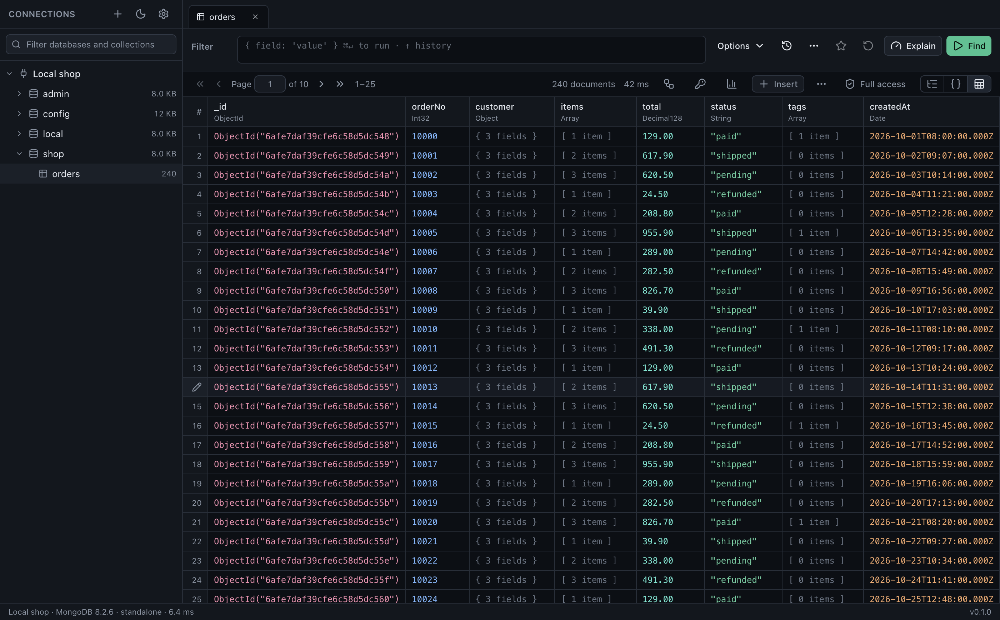
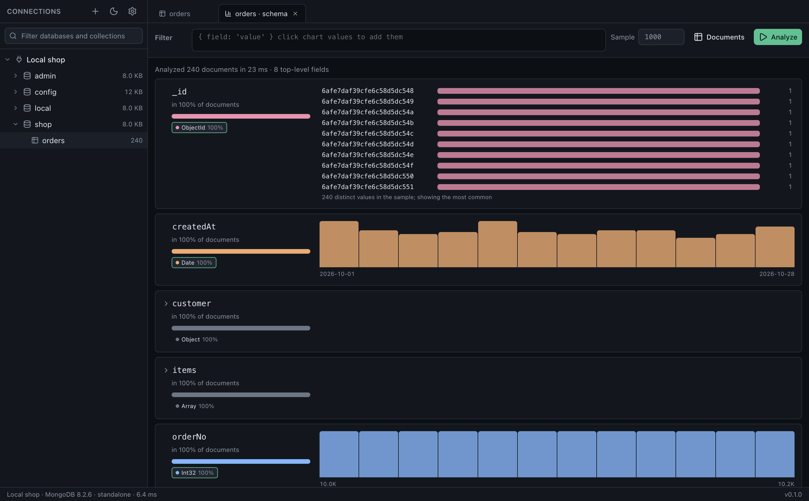
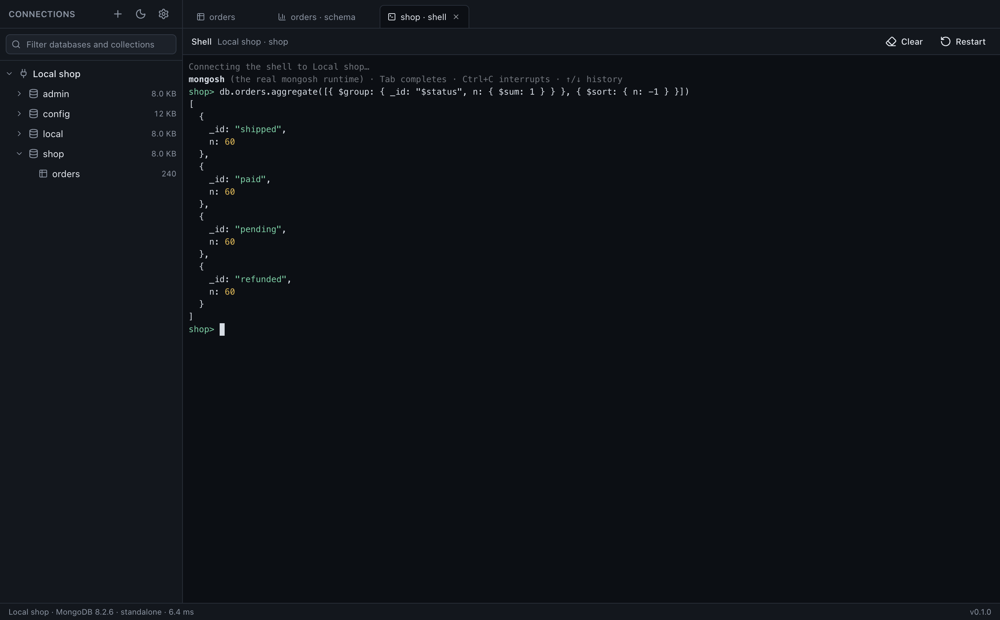

# Mongo Studio

A fast desktop client for MongoDB, built with Electron, React and TypeScript. It keeps every BSON type
exact while you browse, edit, import and export, and it knows what your user is allowed to do.



## Features

- **Connections:** connection strings or a form (SCRAM, X.509, TLS, SSH tunnels). Passwords are
  encrypted with the OS keychain and never reach the UI process. Read-only mode per connection, and
  production connections ask before every write.
- **Query bar:** Compass-style filter, projection, sort, collation, hint, skip, limit and maxTimeMS.
  Autocomplete for fields (sampled), operators and values, with hover docs. History and favourites.
  Export the query to Node, Python, Java, C#, Go or mongosh.
- **Documents:** tree, JSON and table views, 25 per page; large documents are previewed without
  freezing. Documents cross from the main process as raw BSON, so Int64, Decimal128, dates and
  binaries are never rounded or reinterpreted.
- **Editing:** inline, type-aware editing with undo, a conflict check when someone else changed the
  document, bulk update and delete with a preview.
- **Permissions:** writes your user can't do are disabled with the reason (from your roles and from
  errors the server returned).
- **Aggregation builder:** stage cards with live previews, or the whole pipeline as text. Saved
  pipelines; create a view. Previews never run `$out`/`$merge`.
- **Indexes and explain:** index sizes and usage, create, hide and drop. A visual explain plan
  with an index suggestion (equality, sort, range).
- **Shell:** the real mongosh runtime in a tab, with completion, Ctrl+C to interrupt and history.
- **Schema, import and export:** schema analysis with charts; streaming JSON, JSONL and CSV import and
  export with progress and cancel.
- **Workspace:** tabs across connections, split view, pinned tabs, a command palette (⌘/Ctrl+K), and
  your tabs are restored on restart.

| Table view                           | Schema                                 | Shell                                |
| ------------------------------------ | -------------------------------------- | ------------------------------------ |
|  |  |  |

## Install

Download the installer for your OS from the
[latest release](https://github.com/dewMyth/simple-mongoldb-client/releases/latest):

| OS      | File                                                                 |
| ------- | -------------------------------------------------------------------- |
| macOS   | `Mongo-Studio-<version>-mac-universal.dmg` (Apple silicon and Intel) |
| Windows | `Mongo-Studio-<version>-win-x64-setup.exe`                           |

The installers are **not code-signed yet**, so the OS warns on first launch:

- **macOS:** open the app once from Finder with right-click → Open, or run
  `xattr -dr com.apple.quarantine "/Applications/Mongo Studio.app"`.
- **Windows:** SmartScreen → More info → Run anyway.

`SHA256SUMS.txt` in each release lists the files' checksums. Linux builds are paused for now
(`npm run dist -- --linux` builds an AppImage locally).

## Compared with MongoDB Compass

Compass is MongoDB's official GUI and does more in several areas. This table is meant to help you
choose, not to claim one is better. It compares Compass 1.4x as documented at the time of writing.

| Feature                                          | Mongo Studio                   | Compass                           |
| ------------------------------------------------ | ------------------------------ | --------------------------------- |
| Query bar (filter, project, sort, collation…)    | Yes, same syntax               | Yes                               |
| Field/operator autocomplete                      | Yes (sampled fields, values)   | Yes                               |
| Export query/pipeline to code                    | 6 languages                    | Several languages                 |
| Tree / JSON / table document views               | Yes                            | Yes                               |
| Type-exact editing (Int64, Decimal128…)          | Yes (raw BSON end to end)      | Yes                               |
| Bulk update/delete with preview                  | Yes                            | Yes                               |
| Aggregation builder with stage previews          | Yes                            | Yes                               |
| Explain plan and indexes                         | Yes                            | Yes                               |
| Embedded mongosh                                 | Yes                            | Yes                               |
| Schema analysis                                  | Yes                            | Yes                               |
| JSON/CSV import and export                       | Yes (streaming)                | Yes                               |
| Split view (two tabs side by side)               | Yes                            | No                                |
| Disables writes your roles don't allow, with why | Yes                            | Partly (errors after the attempt) |
| Confirm every write on production connections    | Yes                            | No (connection colours instead)   |
| Read-only mode                                   | Per connection, toggle per tab | App-wide setting                  |
| Auth: SCRAM, X.509                               | Yes                            | Yes                               |
| Auth: Kerberos, LDAP, AWS IAM, OIDC              | No                             | Yes                               |
| Schema validation rules editor                   | No                             | Yes                               |
| Queryable Encryption / CSFLE                     | No                             | Yes                               |
| Atlas integration, AI query generation           | No                             | Yes                               |
| Signed installers and auto-update                | Not yet                        | Yes                               |

## Develop

Requires Node 24.

```sh
npm install          # also rebuilds native modules for Electron
npm run dev          # app with hot reload
npm run typecheck && npm test   # unit + integration (MongoDB via mongodb-memory-server)
npm run test:e2e     # builds, then Playwright E2E against the app
npm run dist         # installer for the current OS in release/
```

- Architecture and conventions: [CLAUDE.md](CLAUDE.md); the build plan: [PLAN.md](PLAN.md).
- Releasing and code signing: [docs/release.md](docs/release.md).
- Performance measurements: [docs/perf.md](docs/perf.md).
- README screenshots: `npm run build && SCREENSHOTS=1 npx playwright test screenshots`.
